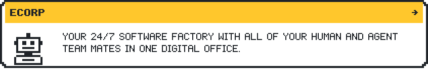
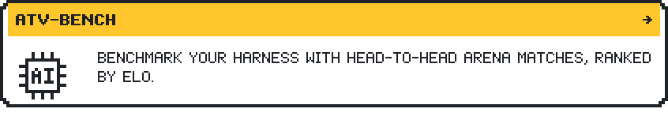
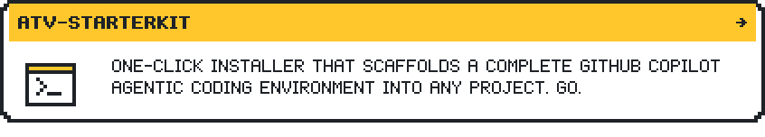

<picture>
  <source media="(max-width: 600px)" srcset="assets/hero-phone.svg">
  <source media="(prefers-color-scheme: dark)" srcset="assets/hero-dark.svg">
  
</picture>

**Forward Deployed Engineer @ Microsoft** | Community Lead at [All The Vibes](https://github.com/All-The-Vibes)

<h2>
<picture><source media="(max-width: 600px)" srcset="assets/projects-phone.svg"><source media="(prefers-color-scheme: dark)" srcset="assets/projects-dark.svg"></picture>
</h2>

<a href="https://github.com/All-The-Vibes/ecorp"><picture><source media="(max-width: 600px)" srcset="assets/project-ecorp-phone.svg"><source media="(prefers-color-scheme: dark)" srcset="assets/project-ecorp-dark.svg"></picture></a> 
<a href="https://github.com/All-The-Vibes/ATV-bench"><picture><source media="(max-width: 600px)" srcset="assets/project-atv-bench-phone.svg"><source media="(prefers-color-scheme: dark)" srcset="assets/project-atv-bench-dark.svg"></picture></a> 
<a href="https://github.com/All-The-Vibes/ATV-StarterKit"><picture><source media="(max-width: 600px)" srcset="assets/project-atv-starterkit-phone.svg"><source media="(prefers-color-scheme: dark)" srcset="assets/project-atv-starterkit-dark.svg"></picture></a>

<h2>
<picture><source media="(max-width: 600px)" srcset="assets/interests-heading-phone.svg"><source media="(prefers-color-scheme: dark)" srcset="assets/interests-heading-dark.svg"></picture>
</h2>

<picture>
  <source media="(max-width: 600px)" srcset="assets/interests-phone.svg">
  <source media="(prefers-color-scheme: dark)" srcset="assets/interests-dark.svg">
  
</picture>

<a href="https://github.com/All-The-Vibes"><picture><source media="(max-width: 600px)" srcset="assets/link-community-phone.svg"><source media="(prefers-color-scheme: dark)" srcset="assets/link-community-dark.svg"></picture></a>
<a href="https://www.linkedin.com/in/stephanieschofield/"><picture><source media="(max-width: 600px)" srcset="assets/link-linkedin-phone.svg"><source media="(prefers-color-scheme: dark)" srcset="assets/link-linkedin-dark.svg"></picture></a>

Text-only profile

### Hey, I'm Stephanie 👋

I give AI agents jobs. Yes, they get performance reviews.

**Forward Deployed Engineer @ Microsoft** | Community Lead at [All The Vibes](https://github.com/All-The-Vibes)

#### Currently focused on

- [**ECorp**](https://github.com/All-The-Vibes/ecorp): Your 24/7 software factory with all of your human and agent team mates in one digital office.
- [**ATV-bench**](https://github.com/All-The-Vibes/ATV-bench): Benchmark your harness with head-to-head arena matches, ranked by ELO.
- [**ATV-StarterKit**](https://github.com/All-The-Vibes/ATV-StarterKit): One-click installer that scaffolds a complete GitHub Copilot agentic coding environment into any project. Go.

#### Let's chat about

- Multi-agent evals and reliability benchmarks
- 24/7 software factories
- Developer tools and self-optimizing harnesses
- Silo, Paradise, Foundation, GOT 🤝

Find me in [All The Vibes](https://github.com/All-The-Vibes) or on [LinkedIn](https://www.linkedin.com/in/stephanieschofield/).

Pixel animation adapted from <a href="https://github.com/Bakar404/Bakar404">Bakar404</a> · <a href="THIRD_PARTY_NOTICES.md">MIT attribution</a> · <a href="docs/profile.md">How to edit</a>
